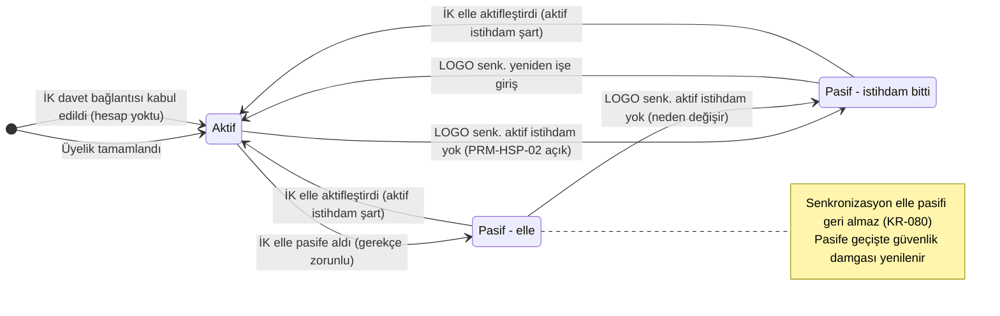
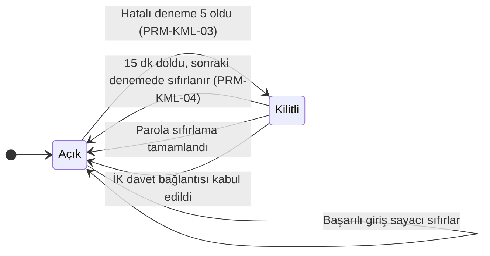
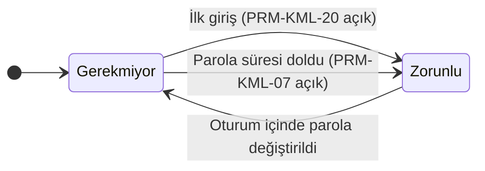
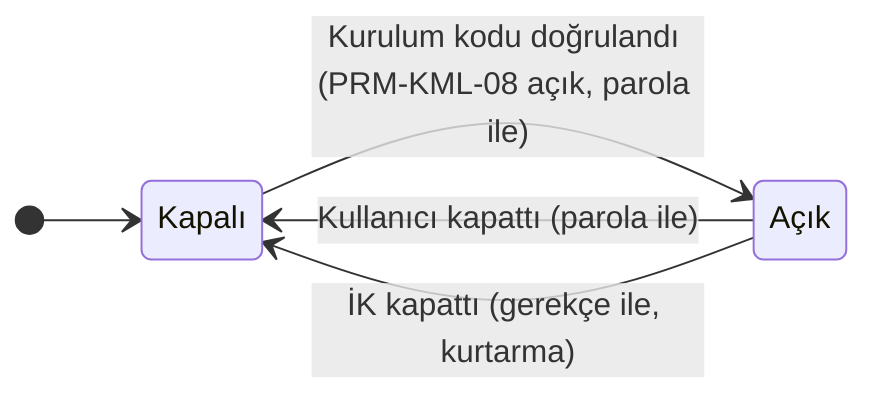
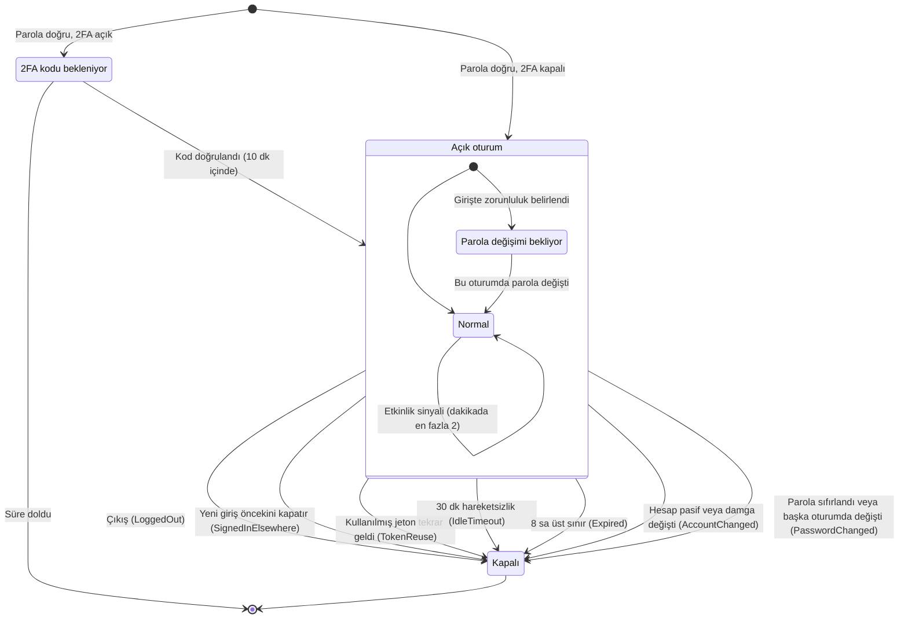
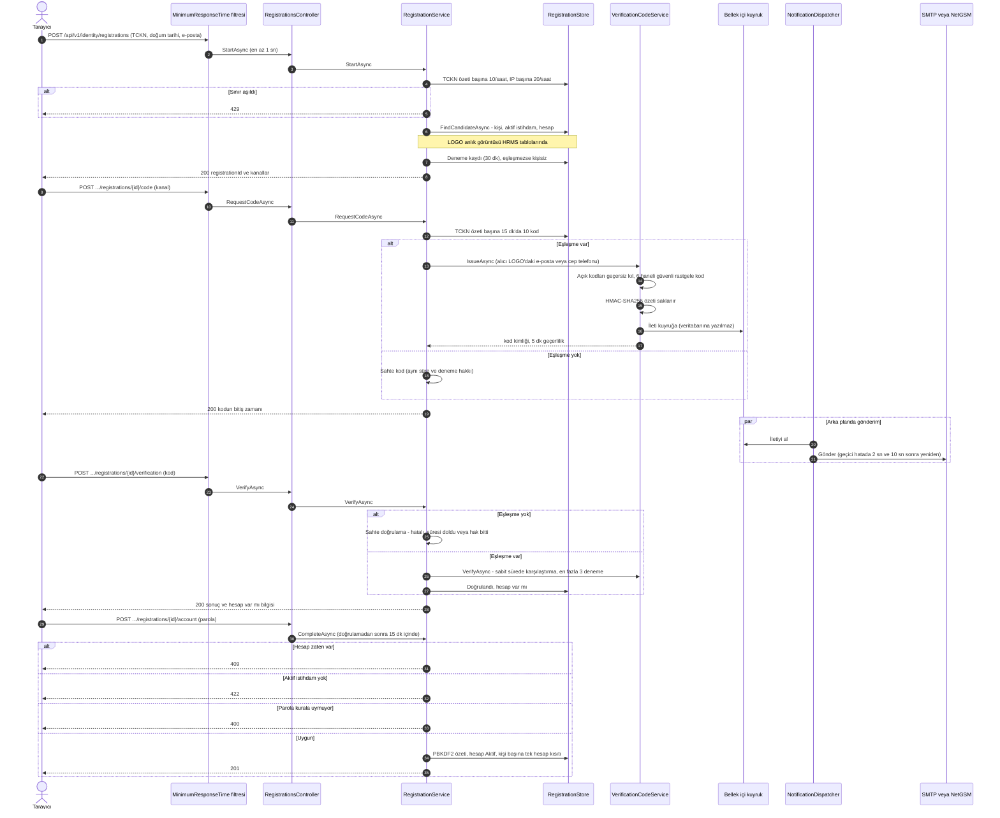

# Kimlik Yönetimi — Tasarım Diyagramları

**Belge kimliği:** MIM-KMLK-DIY
**Süreç:** TEC.5 — Tasarım Tanımlama (çıktı a: öğelerin tasarım özellikleri)
**Son güncelleme:** 2026-10-20
**Kapsam:** T3 Kimlik Yönetimi, `v0.2.0` sonrası `main`

> **Bu belge nedir?** Hesap, giriş kilidi, parola değişimi, 2FA ve oturumun durumlarını;
> üyeliğin uçtan uca akışını gösterir. Diyagramlar **koddan çıkarıldı** (20.10.2026); her
> geçişin kodda nerede olduğu altındaki "Kanıt" tablosundadır. Kod değişip diyagram
> değişmezse diyagram yanlış olur: kimlik akışını değiştiren PR bu belgeyi de günceller
> (TEC.5 YAKLAŞIM §2.3). Kararların gerekçesi ADR-0006, ADR-0012 ve ADR-0017'dedir.
>
> Satır numaraları `src/backend` köküne göredir. Kısaltmalar: `D/` =
> `Dsg.Hrms.Domain/Identity`, `A/` = `Dsg.Hrms.Application/Identity`, `Api/` =
> `Dsg.Hrms.Api/Identity`, `I/` = `Dsg.Hrms.Infrastructure`.

---

## 1. Hesap durumu

Hesabın **yalnızca iki durumu** vardır: Aktif ve Pasif. Pasifliğin nedeni ayrı bir alanda
tutulur (`StatusReason`: istihdam bitti, elle). Giriş kilidi, parola değişimi zorunluluğu
ve 2FA tercihi **durum değil, bağımsız bayraktır** (§2).

**Kanıt**

| Geçiş / olgu | Tetikleyen | Dosya:satır |
|---|---|---|
| Durumlar ve neden alanı | `AccountStatus`, `AccountStatusReason` | D/UserAccount.cs:370-400 |
| Üyelikle oluşma | `RegistrationService.CompleteAsync` → `UserAccount.Register` | A/Registration/RegistrationService.cs:279; D/UserAccount.cs:99-111 |
| Davetle oluşma | `InvitationService.AcceptAsync` → `UserAccount.Register` | A/Invitations/InvitationService.cs:225-228 |
| İstihdam bitince pasif | `PersonnelSynchronizer.ApplyAccountLifecycle` → `DeactivateForEmploymentEnd` | Dsg.Hrms.Application/Personnel/Sync/PersonnelSynchronizer.cs:403-411; D/UserAccount.cs:259-275 |
| Yeniden işe girişte aktif (yalnızca istihdam nedeniyle pasif olan) | `ReactivateForNewEmployment` | PersonnelSynchronizer.cs:396-401; D/UserAccount.cs:288-299 |
| Elle pasif; oturumlar o anda kapanır; kendi hesabı ve son sistem yöneticisi pasife alınamaz | `AccountAdministrationService.DeactivateAsync` | Api/AccountsController.cs:61-69; A/Accounts/AccountAdministration.cs:172-200 |
| Elle aktif (aktif istihdam yoksa reddedilir) | `ActivateAsync` → `ActivateManually` | Api/AccountsController.cs:83-91; AccountAdministration.cs:207-225 |
| Pasife geçişte güvenlik damgası | `SetPassive` | D/UserAccount.cs:347-356 |

**Not:** Senkronizasyonla pasife düşen hesabın açık oturumu o anda kapanmaz. Güvenlik
damgası yenilenir; oturum bir sonraki istekte veya jeton yenilemede `AccountChanged`
nedeniyle kapanır (§3). Elle pasife almada oturumlar hemen kapatılır.

---

## 2. Hesaba bağlı bayraklar

### 2.1 Giriş kilidi

Sayaç **hesaba değil, girilen e-posta adresine** bağlıdır (e-postanın HMAC özeti,
`LoginThrottle`). Böylece var olmayan bir adres için de aynı davranış görülür (ADR-0006 §5).
İK'nın kilidi doğrudan kaldırdığı bir uç nokta yoktur; kilit davet bağlantısıyla veya
kullanıcının parola sıfırlamasıyla kalkar.

### 2.2 Parola değişimi zorunluluğu

### 2.3 2FA tercihi

**Kanıt**

| Geçiş / olgu | Tetikleyen | Dosya:satır |
|---|---|---|
| Sayaç e-postaya bağlı | `LoginThrottle` | D/SessionRecords.cs:46-125 |
| Hatalı deneme, kilitlenme, kilitliyken 429 | `SessionService.SignInAsync` | A/Sessions/SessionService.cs:113-136 |
| Süre dolunca açılma (sonraki denemede) | `LoginThrottle.IsLocked` | D/SessionRecords.cs:83-99 |
| Başarılı girişte sıfırlama | `throttle.Reset`, `Account.ClearLockout` | SessionService.cs:138-139 |
| Oturum içinde yanlış mevcut parola da sayılır | `VerifyCurrentPasswordAsync` | SessionService.cs:591-649 |
| Parola sıfırlama ve davet kabulünde kilidin kalkması | `ResetPasswordAsync`, `AcceptAsync` | RegistrationService.cs:338-351; InvitationService.cs:234-247 |
| Parola değişimi zorunluluğu: oturuma yazılır, istekte 403 | `UserSession.PasswordChangeRequired`, `PasswordChangeGateFilter` | D/UserSession.cs:72, 84-105; Api/Authentication.cs:75-91; Api/PasswordChangeGate.cs:53 |
| Zorunluluğun kalkması | `ChangePasswordAsync` | SessionService.cs:388-389 |
| 2FA açma ve kapatma | `StartTwoFactorSetupAsync`, `CompleteTwoFactorSetupAsync`, `DisableTwoFactorAsync` | Api/AccountController.cs:86-134; A/Sessions/SessionService.TwoFactorPreference.cs:60-180 |
| İK'nın 2FA'yı kapatması (kişi kendi hesabında kullanamaz) | `ResetTwoFactorAsync` | Api/AccountsController.cs:105-113; AccountAdministration.cs:240-258 |
| Girişte kod istenme koşulu: hesap tercihi ve PRM-KML-08 birlikte açık | `SignInAsync` | SessionService.cs:151-160 |

**Not:** `UserAccount.LockedUntil` yalnızca denetim izi içindir; süre dolduğunda kendiliğinden
temizlenmez. Bir rapor bu alana bakarak "kilitli" derse yanılır; kilidin tek doğru kaynağı
`LoginThrottle`'dır (tasarım gözden geçirme raporu 2026-10-20, BG-04).

---

## 3. Oturum yaşam döngüsü

**Kanıt**

| Adım / olgu | Tetikleyen | Dosya:satır |
|---|---|---|
| Giriş | `POST /api/v1/identity/sessions` → `SignInAsync` | Api/SessionsController.cs:50-67; SessionService.cs:89-164 |
| 2FA bekleme kaydı (10 dk) | `LoginChallenge.Start` | D/SessionRecords.cs:133, 164-180 |
| Tek aktif oturum (PRM-KML-14) | `OpenSessionAsync` → `End(SignedInElsewhere)` | SessionService.cs:446-480 |
| 8 sa üst sınır (PRM-KML-12), 15 dk erişim jetonu (PRM-KML-11) | `UserSession.Start`, `IssueTokensAsync` | SessionService.cs:457-462, 511-512; D/UserSession.cs:84-105 |
| Yenileme jetonu: 256 bit, veritabanında SHA-256 özeti; HttpOnly, Secure, SameSite=Strict çerez | `IssueTokensAsync`, `ToResponse` | SessionService.cs:436-437, 506-508; SessionsController.cs:156-166 |
| Jeton yenileme; kullanılmış jeton tekrar gelirse hesabın tüm oturumları kapanır | `RefreshAsync` | SessionsController.cs:109-123; SessionService.cs:247-296 |
| Etkinlik sinyali (üst sınırı uzatmaz); istemci 60 sn aralıkla, yalnızca etkileşim varsa gönderir | `RecordActivityAsync`; `sessionManager.flushActivity` | SessionService.cs:304-319; D/UserSession.cs:140-161; `src/frontend/dsg-hrms-web/src/shared/auth/sessionManager.ts:108, 275-293` |
| Her istekte oturum denetimi; sıra: hesap, üst sınır, hareketsizlik | `OnTokenValidated` → `CheckSessionAsync` → `UserSession.Check` | Api/Authentication.cs:75-91; SessionService.cs:412-433; D/UserSession.cs:114-133 |
| Çıkış | `DELETE .../sessions/current` → `SignOutAsync` | SessionsController.cs:147-154; SessionService.cs:322-337 |
| Parola değişimi: bu oturum açık kalır, diğerleri kapanır; sıfırlama ve davet kabulünde hepsi kapanır | `ChangePasswordAsync`, `ResetPasswordAsync`, `AcceptAsync` | SessionService.cs:388-399; RegistrationService.cs:341-344; InvitationService.cs:237-240 |
| Kapanma nedenleri | `SessionEndReason` | D/UserSession.cs:196-218 |

---

## 4. Üyelik akışı

Parola sıfırlama aynı akışı kullanır (`/api/v1/identity/password-resets`); son adımı
hesap oluşturmak yerine parolayı yeniler.

**Kanıt**

| Adım | Sınıf / metot | Dosya:satır |
|---|---|---|
| Uç noktalar | `RegistrationsController` | Api/RegistrationsController.cs:26-120 |
| Yanıt süresi alt sınırı: ilk üç adımda en az 1 sn; dördüncü adımda yok | `MinimumResponseTimeAttribute` | Api/MinimumResponseTimeAttribute.cs:22-51; RegistrationsController.cs:45, 67, 86 |
| TCKN ve IP sınırları (PRM-KML-18, 19) | `EnforceAttemptLimitsAsync` | RegistrationService.cs:396-416 |
| Kişi arama ve eşleştirme koşulları (aktif istihdam, doğum tarihi, e-posta, kabul edilen alan adı, paylaşılmayan adres) | `FindCandidateAsync`, `MatchAsync` | I/Identity/RegistrationStore.cs:38-89; RegistrationService.cs:438-478 |
| Kod sınırı (PRM-KML-17), üretim ve özet | `IssueAsync`, `Generate`, `HmacVerificationCodeHasher` | RegistrationService.cs:139-147; A/Verification/VerificationCodeService.cs:59-110, 185-192; I/Identity/HmacVerificationCodeHasher.cs:35-70 |
| Kuyruk ve arka plan gönderimi | `InMemoryNotificationDispatch`, `NotificationDispatcher` | I/Notifications/InMemoryNotificationDispatch.cs:14-40; I/Notifications/NotificationDispatcher.cs:78-174 |
| Eşleşme yokken sahte kod ve doğrulama | `DecoyCodeSent`, `VerifyDecoy` | RegistrationService.cs:180-213; D/RegistrationAttempt.cs:140-174 |
| Doğrulama, sabit sürede karşılaştırma | `VerifyCoreAsync`, `Matches` | VerificationCodeService.cs:138-182; HmacVerificationCodeHasher.cs:38-53 |
| Hesap oluşturma ve 409/422/400 | `CompleteAsync`; tek hesap kısıtı `ix_user_account_person_id` | RegistrationService.cs:245-288; I/Identity/RegistrationStore.cs:67-79 |

**Bilinen sınırlar** (tasarım gözden geçirme raporu 2026-10-20, BG-01…BG-03):
- 1 sn bir alt sınırdır, tam eşitleme değildir: iş 1 sn'yi aşarsa yanıt süresi farkı kalır.
  Eşleşmede telefon yoksa yalnızca e-posta sunulur, eşleşmezse iki kanal birden; bu bilinen
  ve kabul edilmiş farktır (`KR-078`).
- Kuyruk doluysa kod kaydedilir ama gönderilmez; kullanıcıya hata dönmez, yalnızca günlüğe
  yazılır.
- Kuyruk bellektedir: uygulama yeniden başlarsa bekleyen iletiler kaybolur (`KR-082`).
  Kullanıcı kodu yeniden ister.

---

## Değişiklik Geçmişi

| Tarih | Sürüm | Değişiklik | Yapan |
|---|---|---|---|
| 2026-10-20 | 1.0 | İlk oluşturma — koddan çıkarılan hesap, bayrak, oturum ve üyelik diyagramları (#234) | Bilgi İşlem |
