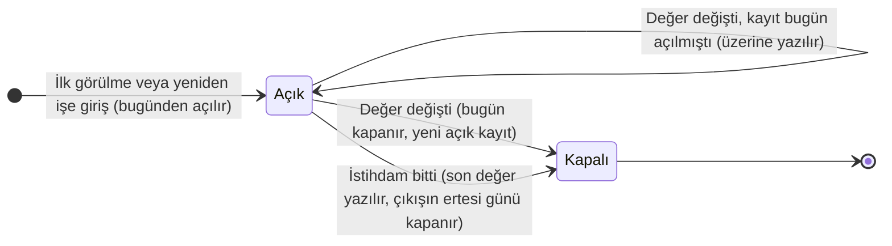
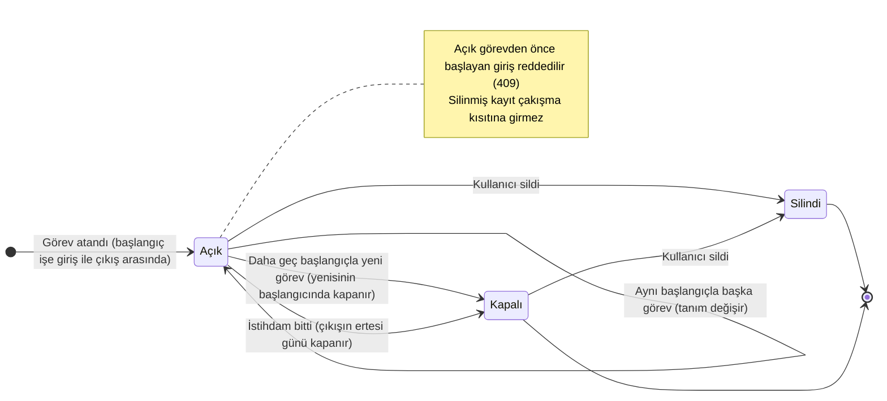
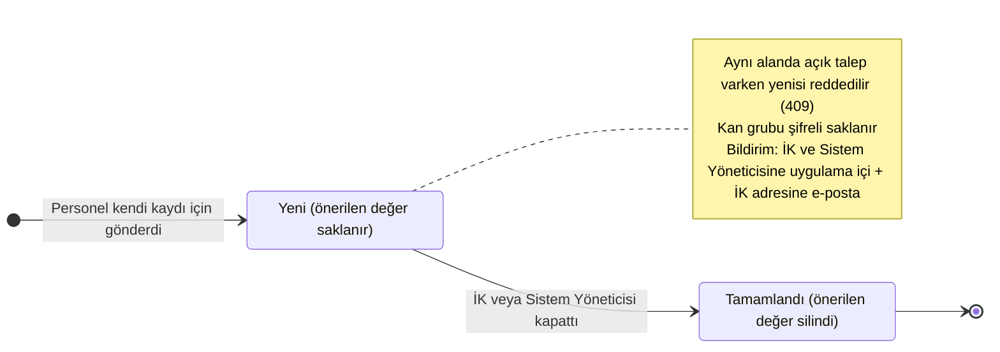
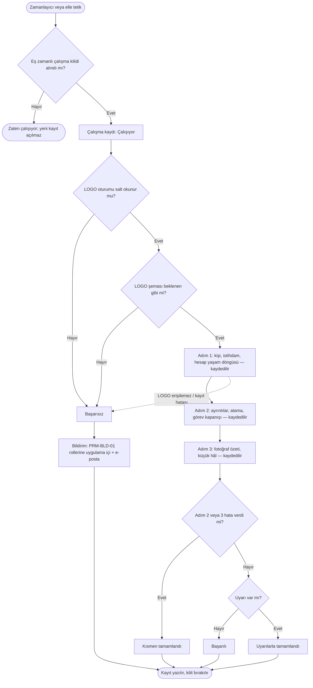

# Personel Yönetimi — Tasarım Diyagramları

**Belge kimliği:** MIM-PERS-DIY
**Süreç:** TEC.5 — Tasarım Tanımlama (çıktı a: öğelerin tasarım özellikleri)
**Son güncelleme:** 2026-11-14
**Kapsam:** T1 Personel Yönetimi, `main` (14.11.2026)

> **Bu belge nedir?** T1'in durum taşıyan üç yapısını gösterir: tarih aralıklı kayıtlar
> (atama ve görev), düzeltme talebi ve senkronizasyon çalışmasının adımları. Diyagramlar
> **koddan çıkarıldı** (14.11.2026, #389); her geçişin kodda nerede olduğu altındaki "Kanıt"
> tablosundadır. Kod değişip diyagram değişmezse diyagram yanlış olur: bu akışları
> değiştiren PR bu belgeyi de günceller (TEC.5 YAKLAŞIM §2.3). Kararların gerekçesi
> ADR-0003, ADR-0021 ve ADR-0022'dedir; durum tabloları SYG-PERS §3'tedir.
>
> Satır numaraları `src/backend` köküne göredir. Kısaltmalar: `D/` =
> `Dsg.Hrms.Domain/Personnel`, `A/` = `Dsg.Hrms.Application/Personnel`, `Api/` =
> `Dsg.Hrms.Api/Personnel`, `I/` = `Dsg.Hrms.Infrastructure`.

---

## 1. Tarih aralıklı kayıtlar

Aralık başlangıç dahil, bitiş hariçtir (`[valid_from, valid_to)`); açık kayıtta bitiş boştur.
Aynı istihdamda en fazla bir açık kayıt vardır ve kayıtlar çakışmaz. Çakışmayı veritabanındaki
`EXCLUDE` kısıtı da engeller (SYG-PERS-018, 019, 021; ADR-0021 §2).

### 1.1 Atama (LOGO kaynaklı: şube, birim, firma, ünvan)

Atamayı yalnızca senkronizasyon yazar; kullanıcı değiştiremez. LOGO bugünkü değeri verir;
geçmiş, değişikliğin görüldüğü günden başlar.

**Kanıt**

| Geçiş / olgu | Tetikleyen | Dosya:satır |
|---|---|---|
| Aralık ve açık kayıt tanımı | `EmploymentAssignment.IsOpen`, `Covers` | D/EmploymentAssignment.cs:11-13, 76-83 |
| İlk görülme veya yeniden işe giriş | `AssignmentTimeline.Apply`, açık kayıt yok | D/EmploymentAssignment.cs:166-170 |
| Değer aynı: değişiklik yok | `open.Values == values` | D/EmploymentAssignment.cs:173-176 |
| Bugün açılmış kayıtta değişiklik: üzerine yazılır | `open.ValidFrom >= today` → `Set` | D/EmploymentAssignment.cs:178-182 |
| Değişiklik: bugün kapanır, yeni kayıt açılır | `Close(today)` + `Open` | D/EmploymentAssignment.cs:184-185 |
| İstihdam bitti: son değer, çıkışın ertesi günü kapanış | `Close(end)` | D/EmploymentAssignment.cs:188-196 |
| Çağıran: senkronizasyonun ayrıntı adımı | `PersonnelDetailsSynchronizer.SynchronizeAssignments` | A/Sync/PersonnelDetailsSynchronizer.cs:172 |
| Çakışma kısıtı | `EXCLUDE USING gist (employment_id, daterange)` | I/Data/Migrations/20261023211027_T1EmploymentAssignments.cs:112 |
| Aralık kısıtı (`valid_to > valid_from`) | `ck_employment_assignment_range` | I/Data/Configurations/EmploymentAssignmentConfiguration.cs:28 |

### 1.2 Görev (HRMS'te girilir)

Görevi `personnel.person.update` izni olan kullanıcı girer; izni olan kullanıcı kendi görevini
de girer (`KR-137`). Görev yumuşak silinir.

**Kanıt**

| Geçiş / olgu | Tetikleyen | Dosya:satır |
|---|---|---|
| Başlangıç işe girişten önce veya çıkıştan sonra: reddedilir | `DutyTimeline.Assign` | D/EmploymentDuty.cs:114-122 |
| Açık görevden önce başlayan giriş: çakışma | `DutyRuleException(isConflict: true)` | D/EmploymentDuty.cs:129-133 |
| Aynı başlangıç: tanım değişir veya değişiklik yok | `Change` / `Unchanged` | D/EmploymentDuty.cs:135-144 |
| Daha geç başlangıç: açık görev kapanır, yenisi açılır | `open.Close(start)` + `Open` | D/EmploymentDuty.cs:146-149 |
| Kapanış tarihi başlangıçtan sonra olur | `Close` | D/EmploymentDuty.cs:60 |
| Çağıran: görev atama | `DutyService.AssignAsync` | A/Duties/DutyService.cs:82-92 |
| İstihdam bitince kapanış | `DutyTimeline.CloseOnTermination` | D/EmploymentDuty.cs:155-172; A/Sync/PersonnelDetailsSynchronizer.cs:153 |
| Silme yumuşaktır | `DutyService.DeleteAsync` → `ISoftDeletable` | A/Duties/DutyService.cs:111-119; I/Data/Interceptors/AuditFieldsInterceptor.cs:74 |
| Çakışma kısıtı silinmemiş kayıtlarda | `EXCLUDE ... WHERE deleted_at IS NULL` | I/Data/Migrations/20261024185229_T1EmploymentDuties.cs:85 |

---

## 2. Düzeltme talebi ("İK'ya bildir")

Talebin **iki durumu** vardır. Önerilen değer yalnızca talep açıkken saklanır; kapanınca silinir
ve talepte yalnızca alan, durum ve tarihler kalır (SYG-PERS-045–049; `KR-126`; ADR-0022 §3).

**Kanıt**

| Geçiş / olgu | Tetikleyen | Dosya:satır |
|---|---|---|
| Gönderme ucu | `POST /api/v1/personnel/corrections/me` | Api/CorrectionsController.cs:65-72 |
| Aynı alanda açık talep: çakışma | `ListOpenFieldsAsync` | A/Corrections/CorrectionService.cs:154-158 |
| Talep "Yeni" olarak oluşur | `CorrectionRequest.Submit` | D/CorrectionRequest.cs:70-80; A/Corrections/CorrectionService.cs:160-162 |
| Kan grubu şifrelenir | `ProtectValue` | D/CorrectionRequest.cs:89-96; I/Personnel/CorrectionStore.cs:61 |
| Alıcılar: İK ve Sistem Yöneticisi rolü (`KR-132`) | `ListRecipientsAsync` | I/Personnel/CorrectionStore.cs:33-37 |
| Uygulama içi bildirim talep ile aynı işlemde | `InboxItem.For` + `SaveChangesAsync` | A/Corrections/CorrectionService.cs:164-167 |
| E-posta, kayıttan sonra kuyruğa | `NotifyByEmailAsync` | A/Corrections/CorrectionService.cs:169, 242-251 |
| Kapatma ucu | `POST .../corrections/{id}/complete` | Api/CorrectionsController.cs:127 |
| Kapatma: durum, tarih, önerilen değer silinir | `CorrectionRequest.Complete` | D/CorrectionRequest.cs:103-114; A/Corrections/CorrectionService.cs:209-219 |
| Kapalı talep yeniden kapatılamaz | `ConflictException` | A/Corrections/CorrectionService.cs:214-216; D/CorrectionRequest.cs:105-108 |

---

## 3. Senkronizasyon çalışması

T3'ün çalışması T1'de iki adımla genişledi: ayrıntılar (yeni alanlar, atama, görev kapanışı)
ve fotoğraflar. Yeni adımlar ilk adım kaydedildikten **sonra** çalışır; hataları önceki adımı
geri almaz ve çalışma "Kısmen tamamlandı" olur (SYG-PERS-007, 011–014; ADR-0003; ADR-0021 §4–§5).

**Kanıt**

| Adım / olgu | Tetikleyen | Dosya:satır |
|---|---|---|
| Zamanlayıcı; periyot parametreden (`PRM-ENT-07`), elle tetik bekleme sırasında | `PersonnelSyncWorker` | I/Personnel/PersonnelSyncWorker.cs:97-112 |
| Eş zamanlı çalışma kilidi | `TryOpenSessionAsync` → `pg_try_advisory_xact_lock` | A/Sync/PersonnelSyncService.cs:62-68; I/Personnel/PersonnelSyncStore.cs:59-76 |
| Çalışma kaydı açılır | `PersonnelSyncRun.Start` | A/Sync/PersonnelSyncService.cs:70-71; D/Sync/PersonnelSyncRun.cs:88 |
| Salt okunur oturum denetimi | `VerifyReadOnlyAccessAsync` | A/Sync/PersonnelSyncService.cs:98-104; I/Logo/LogoPersonnelSource.cs:38 |
| Şema denetimi (SYG-PERS-011) | `VerifySchemaAsync` | A/Sync/PersonnelSyncService.cs:107-111; I/Logo/LogoPersonnelSource.cs:58 |
| Adım 1 ve kaydı | `PersonnelSynchronizer.Synchronize` + `CommitAsync` | A/Sync/PersonnelSyncService.cs:118-125 |
| Adım 2 (ilk adım kaydedildikten sonra) | `RunDetailsStepAsync` → `BeginNextStepAsync` | A/Sync/PersonnelSyncService.cs:129, 178-201; I/Personnel/PersonnelSyncStore.cs:167 |
| Adım 3 (en son) | `RunPhotoStepAsync` | A/Sync/PersonnelSyncService.cs:132, 228-252 |
| Sonuç: kısmen, başarılı, uyarılarla | `CompletePartially` / `Complete` | A/Sync/PersonnelSyncService.cs:139-146; D/Sync/PersonnelSyncRun.cs:96-133 |
| Başarısızlık nedenleri | `LogoUnavailableException`, `SyncPersistenceException`, beklenmeyen | A/Sync/PersonnelSyncService.cs:150-170 |
| Kayıt iptalde de yazılır | `SaveRunAsync(run, CancellationToken.None)` | A/Sync/PersonnelSyncService.cs:80-82 |
| Bildirim yalnızca başarısızlıkta; şema sapması ayrı tür (SYG-PERS-012, `KR-133`, `KR-134`) | `PersonnelSyncAlerts.NotifyAsync` | A/Sync/PersonnelSyncService.cs:85; A/Sync/PersonnelSyncAlerts.cs:107-112, 133 |

---

## Değişiklik Geçmişi

| Tarih | Sürüm | Değişiklik | Yapan |
|---|---|---|---|
| 2026-11-14 | 1.0 | İlk oluşturma — koddan çıkarılan tarih aralıklı kayıt, düzeltme talebi ve senkronizasyon diyagramları (T1 geliştirme sonu denetimi TEC.5-11, #389) | Bilgi İşlem |
